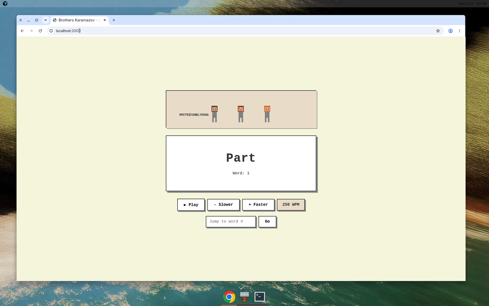

# broskaraoneword

A minimalistic one-word-at-a-time ebook reader for *The Brothers Karamazov* by Fyodor Dostoevsky.



## Features

- 📖 Read one word at a time for easier focus
- ⚡ Adjustable reading speed (default 250 WPM)
- ⏯️ Play/pause controls
- 🔢 Word counter to track your progress
- 💾 Auto-saves your position
- 🎨 Retro pixel art design
- ⌨️ Keyboard shortcuts (Space to play/pause, Arrow keys to adjust speed)

## Installation

```bash
npm install
```

## Usage

```bash
npm start
```

Then open your browser to the displayed URL (typically http://localhost:3000).

## Controls

- **Play/Pause**: Click the button or press `Space`
- **Speed Up/Down**: Use the +/- buttons or `Arrow Up`/`Arrow Down` keys
- **Jump to Position**: Enter a word number and click "Go"

## License

MIT - The Brothers Karamazov text is in the public domain.
